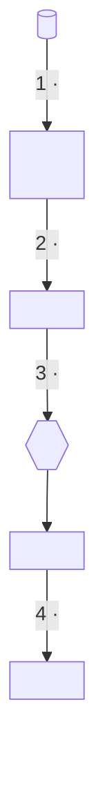
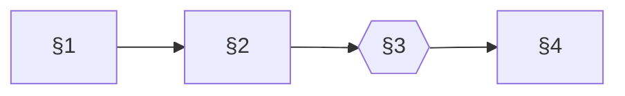

# Page templates

Skeletons for each page type. `<…>` is a placeholder; keep the section order unless the project gives a reason not
to. The examples come from an ML data pipeline (adapters → labels → records → teacher labelling → training →
evaluation); swap in the project's own stages.

## Contents

1. README
2. Stage page
3. Data formats (shapes and API calls)
4. Glossary
5. Operations
6. CONTRIBUTING
7. Tool-folder README
8. history/README

---

## 1. README

````markdown
# <Project name>

<3-4 sentences: what it does, for whom, what it produces. What this repo holds (code? data? both?).>

## How it works



Follow the stages in order. Each page starts with its own flowchart, the files it reads and writes, and a link to the
next stage:

| Stage | Page | You will learn |
|---|---|---|
| — | [Overview](docs/overview.md) | the problem, the full pipeline with file names, where data lives, current state |
| 1 | [<Stage>](docs/<stage>.md) | <what the reader gets from it> |
| … | … | … |

Reference:

| Page | What |
|---|---|
| [Data formats](docs/data-formats.md) | every file and API shape in the pipeline, with field tables and real examples |
| [Glossary](docs/glossary.md) | every project term |
| [Operations](docs/operations.md) | where data lives, running the heavy or paid jobs, rules that always apply |
| [Contributing](CONTRIBUTING.md) | setup, tests, and recipes for the common changes |

## Status (<YYYY-MM-DD>)

| Stage | State |
|---|---|
| <stage> | <done / running / not started, with the one number that matters> |

## Quick start

```bash
<the 2-4 commands that install and run the tests>
```

<One paragraph: what is not in git and why (data, secrets), where it lives, where keys are read from.>

## Repository layout

| Path | What |
|---|---|
| `<folder>/` | <one line> ([README](<folder>/README.md)) |
| `docs/` | the documentation above |
| `history/` | process records: audit log, review requests, validation reports ([README](history/README.md)) |
````

## 2. Stage page

````markdown
# Stage <N> · <Name>

[← Stage <N-1>, <Name>](<prev>.md) · [Docs home](../README.md) · [Next: Stage <N+1>, <Name> →](<next>.md)

<1-2 sentences: what this stage produces and why it exists.>

```mermaid
flowchart LR
    IN["<input><br/><path>"] --> S["<script> <key flags>"]
    S --> OUT["<output><br/><path>"]
    OUT --> NEXT["Stage <N+1>: <name>"]
```



| | |
|---|---|
| Input | [<shape>](data-formats.md#<n>-<shape>) |
| Code | `<paths>` (entry point `<file>`) |
| Output | [<shape>](data-formats.md#<n>-<shape>) in `<path>` |
| Run | `<the exact command, on sample data if there is any>` |

## Terms

| Term | Meaning |
|---|---|
| <term> | <one line, plain words> |

## What it guarantees

- **<Property>.** <one or two sentences, and the test that checks it>

## <How it works, one section per mechanism>

<Rules as they are now, each with its reason. Tables for anything with options or thresholds.>

## Tests

<Which suites cover this stage and what they check; how to run them.>

---

[← Stage <N-1>, <Name>](<prev>.md) · [Next: Stage <N+1>, <Name> →](<next>.md)
````

## 3. Data formats

The page readers return to. Number the sections so other pages can link `data-formats.md#3-record-row`.

````markdown
# Data formats

[Docs home](../README.md) · [Overview](overview.md)

Every file the pipeline reads or writes and every external API it calls: fields, types and a real, shortened
example. What the fields mean in the domain is in [schema.md](schema.md); how each stage works is on its stage page.

## The flow



| § | Shape | Written by | Read by |
|---|---|---|---|
| [1](#1-<shape>) | <shape> | <script> | <scripts> |

## 1. <Shape>

`<path pattern>`, one JSON line per <unit>. Written by `<script>`; read by `<scripts>`.

| Field | Type | Meaning |
|---|---|---|
| `<field>` | <type> | <meaning; units; what null means> |

```json
{"<field>": "<real value, shortened with …>"}
```

## <n>. <External API call>

`POST <url>` with header `Authorization: Bearer <key>` (key from `<path>`, never in the repo).

| Setting | Value | Why |
|---|---|---|
| `<param>` | `<value>` | <the reason: what breaks or changes without it> |

**Response.** <the fields the code reads, as a table, and a shortened real response>

**Errors.** | Code | Meaning | What the code does | (retry? stop? retry next run?)
````

## 4. Glossary

````markdown
# Glossary

[Docs home](../README.md) · [Overview](overview.md)

Every project term, with a one-line definition and the code that defines it. How the stages fit together:
[overview.md](overview.md). File shapes: [data-formats.md](data-formats.md).

## <Group, e.g. per stage>

| Term | Definition |
|---|---|
| <term> | <one line>. (`<file or function that defines it>`) |
````

## 5. Operations

````markdown
# Operations

[Docs home](../README.md) · [Contributing](../CONTRIBUTING.md)

## Rules that always apply

- <rule> - <why>

## Where data lives

| What | Where | Size | Notes |
|---|---|---|---|

## API keys

<file per provider, permissions, never committed, never printed>

## <Each heavy, slow or paid job>

### Inputs · ### Running it · ### Budget and limits · ### Resume after a stop · ### Checking a run
````

## 6. CONTRIBUTING

````markdown
# Contributing

[README](README.md) · [Overview](docs/overview.md) · [Operations](docs/operations.md)

## Setup
<exact versions where they matter, and why>

## The data you need
| Data | Path | Needed for |

## Running the tests
<the runner, how long a full run takes, how to run a piece>

## Recipes
### Add a <source / endpoint / module>
1. <step, with the file to touch>
2. <the test to add>
3. <the docs to update>

### Change <a rule / the schema / a prompt / the builder>
…

## Commits and review
<branching, commit message style, review process>
````

## 7. Tool-folder README

The command reference for one folder. It does not re-explain concepts; it links to them.

````markdown
# <folder>: <what it does>

[Docs home](../../README.md) · Concepts: [<stage>](../../docs/<stage>.md) · Shapes: [data formats](../../docs/data-formats.md)

<One paragraph and a numbered list of what the folder does, in order.>

Words used here:

| Term | Meaning |
|---|---|

## Pipeline
<Where to run commands from, interpreter, resource limits.>

| Step | Command | Reads | Writes |
|---|---|---|---|

## Files
| File | What |
|---|---|
````

## 8. history/README

````markdown
# History

Process records: <the audit log, review requests, validation reports>. They show how the current state was reached
and checked. You do not need them to use or contribute to the project; the rules and reference material are in
[docs/](../docs/overview.md).

| File | What |
|---|---|

Older records are in git history: `git show <sha>:<path>`.
````
