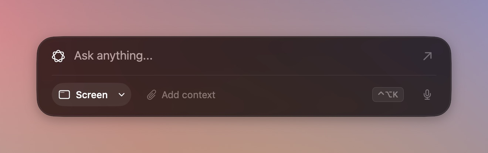
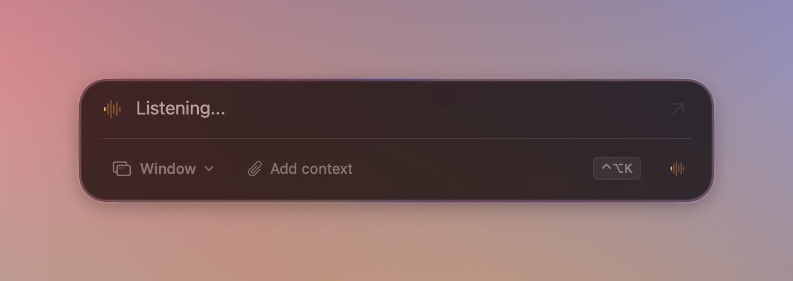
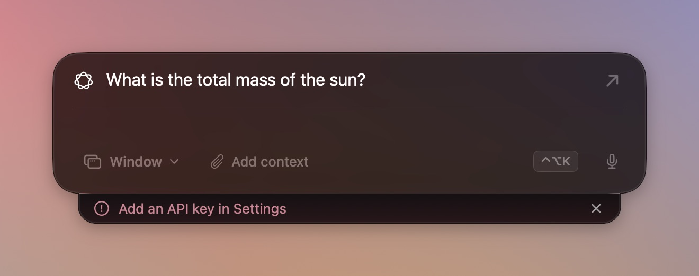
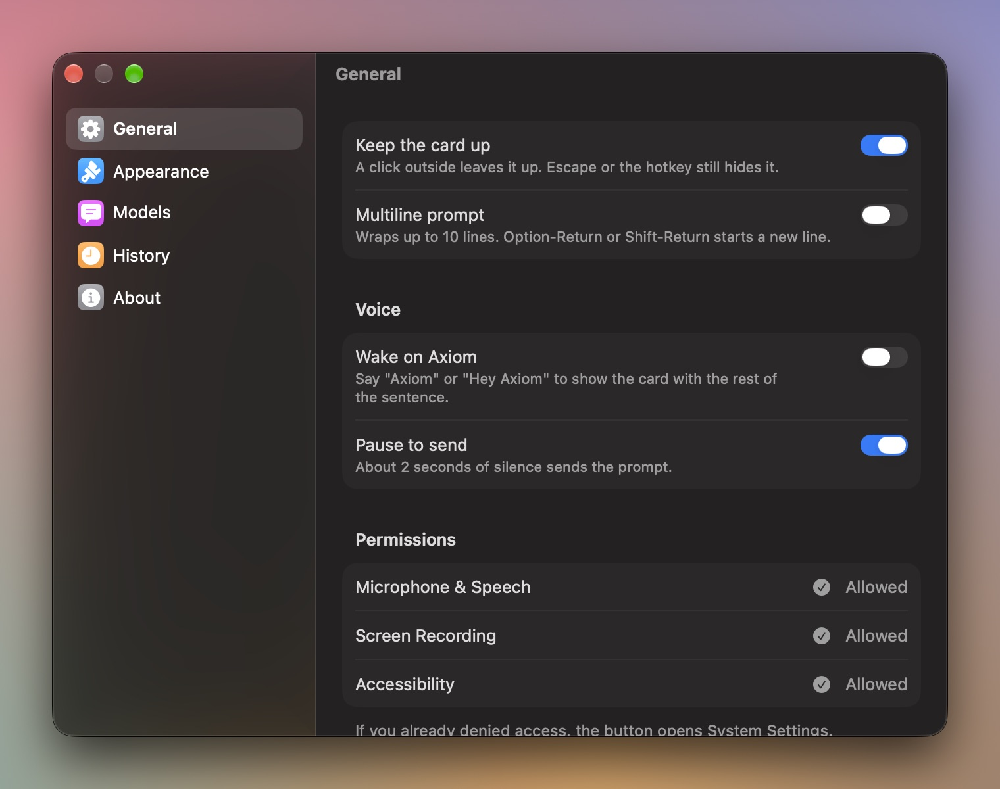
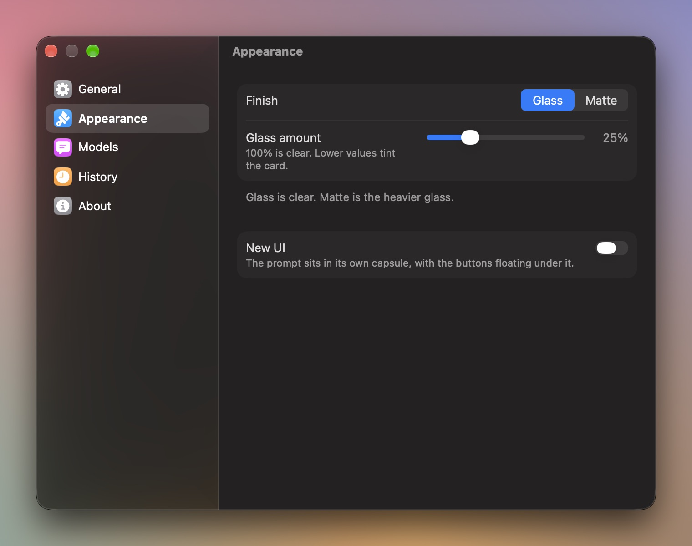
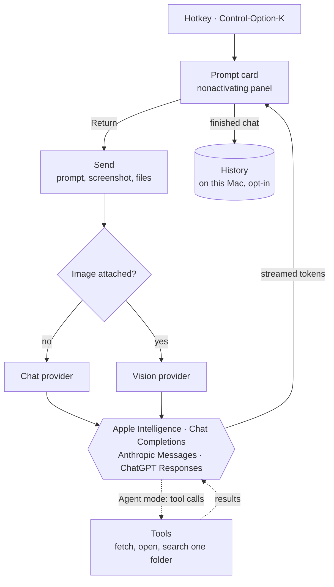

  

<h1 align="center">Axiom</h1>

  A Liquid Glass prompt card for macOS. Press a hotkey, ask, and the reply streams in. Then it gets out of the way.

  

Axiom lives in the menu bar, not the Dock. Control-Option-K opens a glass card over whatever you are doing, without
taking focus from that app. Type or dictate a question, attach your screen or a few files, and the answer streams into
the card from Apple Intelligence on your Mac, or from any OpenAI-compatible, Anthropic, or ChatGPT account you connect.

It needs macOS 26 or later on Apple silicon.

## What it looks like

| | |
|---|---|
|  |  |
| **Formatted replies.** Headings, lists, links and code blocks render. What you type stays plain. | **Screen and Window.** Arm a capture and the next send includes a screenshot of your display or the front window. |
|  |  |
| **Dictation and wake word.** Talk into the field, or say "Hey Axiom". Pause to send. | **Clear errors.** Each failure gets its own sentence on a lip under the card. |

   
  <em>New UI, in Settings → Appearance, splits the card into a prompt capsule and floating buttons.</em>

  
  

## Install

1. Download `Axiom-macOS.zip` from the [latest release](https://github.com/duoi/axiom/releases/latest).
2. Unzip it and move `Axiom.app` to Applications.
3. The build is not notarized, so the first time, right-click the app and choose **Open**. macOS remembers that.
4. Press **Control-Option-K**.

The card starts on **On-device**, which uses Apple Intelligence and needs no account. To use a cloud model, open
Settings → Models → **Add Provider…**, pick a provider and paste its API key. See
[Providers and models](docs/providers.md).

## How it works

| Page | You will learn |
|---|---|
| [Using Axiom](docs/using-axiom.md) | the card, prompts, capture, files, dictation, shortcuts, history, appearance |
| [Providers and models](docs/providers.md) | the built-in presets, chat and vision, what each request sends and why, keys |
| [Agent mode](docs/agent-mode.md) | turning on tools, what each tool can reach, approvals and limits |
| [Privacy and data](docs/privacy-and-data.md) | permissions, what leaves your Mac, where keys and history live, the history file |
| [Contributing](CONTRIBUTING.md) | building, tests, signing, debug launch options, recording captures |

## Shortcuts

| Keys | Does | Where |
|---|---|---|
| Control-Option-K | show or hide the card | anywhere |
| Return | send | card |
| Option-Return, Shift-Return | new line, when the multiline prompt is on | card |
| Escape | hide the card | card |
| Control-S | Screen, then Window, then off | card |
| Control-C | add files | card |
| Control-' | start or stop dictation | card |
| Control-R | leave this chat out of history | card |
| Control-A | switch Ask and Agent, when that control shows | card |

Every shortcut can be changed in Settings → General.

## Status (2026-10-29)

| Area | State |
|---|---|
| Card, streaming, capture, files, dictation, history | working |
| On-device, OpenAI-compatible, Anthropic, ChatGPT subscription | working |
| Agent mode (tools) | experimental, off until turned on in Settings |
| New UI | experimental, off by default |
| Release builds | published from every push to `main`; ad-hoc signed, not notarized |

## Repository layout

| Path | What |
|---|---|
| `AIHUD/` | the app: `Panel/` (window and card controller), `HUD/` (card views), `Chat/` (providers, streaming, agent, voice, history), `Settings/` |
| `AIHUDTests/` | the Swift Testing suite |
| `Config/` | signing settings and the gitignored dev endpoint ([Contributing](CONTRIBUTING.md#signing-and-the-dev-endpoint)) |
| `docs/` | the pages above, and `images/` |
| `notes/` | the development log and the visual reference |
| `.github/workflows/build.yml` | tests, builds and publishes a release |

## License

[MIT](LICENSE). Copyright 2026 Steven Johns.
