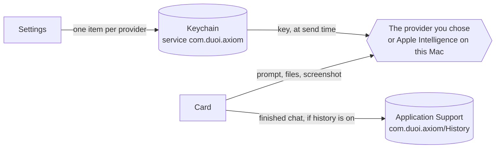

[← Agent mode](agent-mode.md) · [Docs home](../README.md) · [Next: Contributing →](../CONTRIBUTING.md)

# Privacy and data

What Axiom asks permission for, what leaves your Mac, and where it keeps things.



## Permissions

| Permission | Used for | Asked from |
|---|---|---|
| Microphone, Speech Recognition | dictation and the wake word | Settings → General |
| Screen Recording | Screen and Window capture | Settings → General |
| Accessibility | Window capture (finding the front window) | Settings → General |

If macOS has not asked yet, the button in Settings requests access. If you already said no, it opens the matching pane
of System Settings. Axiom never edits the permission database itself.

## What leaves your Mac

| Data | Goes to | When |
|---|---|---|
| Prompt, conversation so far, system prompt | your chat or vision provider | each send |
| Attached files (text, or images as JPEG) | the same provider | the send they are attached to |
| Screenshot | the vision provider | a send with Screen or Window armed |
| Web requests | the URL the model asked for | Agent mode, after you press Allow |

With **On-device**, nothing leaves the Mac: Apple Intelligence runs locally. Axiom has no server and sends no
analytics.

## Keys

| What | Where |
|---|---|
| Each provider's API key | its own Keychain item, account `api-key.<provider id>` |
| ChatGPT sign-in | the ChatGPT row's Keychain item, refreshed when it expires |
| Provider list, models, settings | the app's preferences, never with a key in them |

Keys are never written to logs or error text. Clearing a key field and saving removes that key. Builds from the
release page are ad-hoc signed, so they use the login keychain, and after an update macOS may ask once per key whether
Axiom can use it; choose **Always Allow**.

## History

History is off by default. When it is on, each finished chat is saved to
`~/Library/Containers/com.duoi.axiom/Data/Library/Application Support/com.duoi.axiom/History/`. Nothing is uploaded.

| Rule | Why |
|---|---|
| The newest 500 chats are kept | the file and the screenshots folder cannot grow forever |
| An unreadable `history.json` is renamed `history.corrupt-<time>.json` | the next save would otherwise replace every chat with an empty list |
| Screenshots are a separate switch, off by default | they are full-screen images of whatever was showing |
| Turning screenshots off, or history off, deletes saved screenshots | the chats stay; the images do not outlive your choice |
| Control-R or the incognito mark skips one chat | for a conversation you do not want kept |
| Files you attach are recorded by name only | their contents are never copied into history |

### history.json

A list of chats, newest first.

| Field | Type | Meaning |
|---|---|---|
| `id` | UUID | one chat |
| `startedAt`, `savedAt` | ISO 8601 date | first send, last save |
| `turns` | list | each has `role` (`user` or `assistant`), `text`, and `screenshotNames` (JPEG files in `screenshots/`) |
| `contextFilenames` | list of strings | names of attached files, without their contents |
| `hasScreenshot` | bool | whether any screenshot was saved with this chat |

```json
[
  {
    "id": "6F1C2A9E-1D7B-4C1A-9F55-0B3E7A2D4C10",
    "startedAt": "2026-10-29T15:40:12Z",
    "savedAt": "2026-10-29T15:40:19Z",
    "turns": [
      { "role": "user", "text": "Write a haiku about morning coffee.", "screenshotNames": [] },
      { "role": "assistant", "text": "Steam rises gently,\nDark brew warms the quiet dawn—\nPeace in every sip.", "screenshotNames": [] }
    ],
    "contextFilenames": [],
    "hasScreenshot": false
  }
]
```

## Debug transcript

The menu-bar **Debug** item can show a live transcript of HTTP traffic. It redacts authorization headers, API keys,
bearer tokens and secret query parameters; prompt text stays visible.

[← Agent mode](agent-mode.md) · [Docs home](../README.md) · [Next: Contributing →](../CONTRIBUTING.md)
