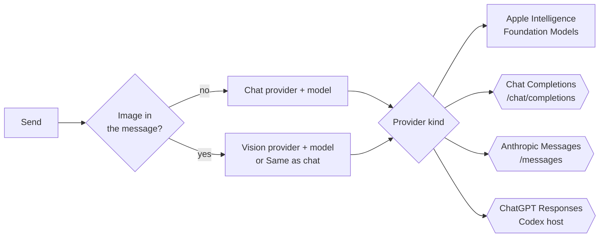

[← Using Axiom](using-axiom.md) · [Docs home](../README.md) · [Next: Agent mode →](agent-mode.md)

# Providers and models

A **provider** is a place replies come from: Apple Intelligence on this Mac, or a cloud account. Each provider row
holds a base URL, a model list and its own key. Settings → Models picks one provider for **chat** and, optionally, a
different one for **vision**.

| Term | Meaning |
|---|---|
| Provider | one row in Settings → Models: name, base URL, kind, models, key |
| Base URL | the host plus version path, for example `https://api.openai.com/v1` |
| Kind | which wire format the provider speaks (the four boxes above) |
| Reasoning effort | how hard a model thinks before answering; shared by Settings and the card's logo menu |

## Add a provider

Settings → Models → **Add Provider…** lists **Custom…** and the presets below. Pick one, paste its key, and press
**Add**. Axiom then asks the host for its model list; pick the chat model in the **Chat** section. **Edit…** on a row
changes it; Control-click a row to delete it. On-device cannot be edited or deleted.

| Name | Base URL | Auth |
| --- | --- | --- |
| On-device | none | Apple Intelligence |
| OpenAI | `https://api.openai.com/v1` | API key |
| Anthropic | `https://api.anthropic.com/v1` | API key |
| ChatGPT | `https://chatgpt.com/backend-api/codex` | ChatGPT subscription |
| OpenRouter | `https://openrouter.ai/api/v1` | API key |
| Venice | `https://api.venice.ai/api/v1` | API key |
| Moonshot AI | `https://api.moonshot.ai/v1` | API key |
| Z.AI | `https://api.z.ai/api/paas/v4` | API key |
| DeepSeek | `https://api.deepseek.com` | API key |
| Alibaba Cloud Model Studio | `https://dashscope-intl.aliyuncs.com/compatible-mode/v1` | API key |
| SiliconFlow | `https://api.siliconflow.com/v1` | API key |
| Cohere | `https://api.cohere.ai/compatibility/v1` | API key |
| Groq | `https://api.groq.com/openai/v1` | API key |
| xAI | `https://api.x.ai/v1` | API key |
| Together AI | `https://api.together.xyz/v1` | API key |
| Fireworks AI | `https://api.fireworks.ai/inference/v1` | API key |
| Cerebras | `https://api.cerebras.ai/v1` | API key |
| Mistral | `https://api.mistral.ai/v1` | API key |
| Meta Muse | `https://api.meta.ai/v1` | API key |
| LM Studio | `http://127.0.0.1:1234/v1` | none required |
| Ollama | `http://127.0.0.1:11434/v1` | none required |
| Unsloth | `http://127.0.0.1:8888/v1` | API key |

**ChatGPT** signs in with your ChatGPT subscription instead of a key: press **Connect** in its editor, finish the sign-in
in the browser, and the token is kept in that row's Keychain item.

## Chat and vision

A send that includes an image (a screenshot or an attached picture) goes to the **Vision** provider; everything else
goes to **Chat**. Vision can be **Same as chat**. If the vision provider is incomplete, the send stops with a message
instead of quietly using the chat model, so an image is never sent somewhere you did not choose.

On-device uses Apple Intelligence through the Foundation Models framework. It needs a Mac with Apple Intelligence
turned on, and image input on that path needs macOS 27.

## What each request sends

Every cloud request streams (server-sent events) and carries the system prompt, the conversation so far, and any
images as JPEG.

### Chat Completions (OpenAI and compatible hosts)

`POST <base URL>/chat/completions`

| Setting | Value | Why |
|---|---|---|
| `Authorization` | `Bearer <key>` | the standard key header for these hosts |
| `stream` | `true` | tokens appear in the card as they arrive |
| `reasoning_effort` | `none` … `high` | your Reasoning choice; sent on every request, including None |
| `tools` | only in Agent mode | Ask never offers tools ([Agent mode](agent-mode.md)) |

### Anthropic Messages

`POST <base URL>/messages`

| Setting | Value | Why |
|---|---|---|
| `x-api-key` | your key | Anthropic's key header |
| `anthropic-version` | `2023-06-01` | the API version the client is written against |
| `thinking` | budget 1024, 2048, 8192 or 16384 tokens | Minimal, Low, Medium, High; None omits it |
| `max_tokens` | 4096, or the thinking budget + 4096 | the reply needs room after the thinking |
| `tools` | only in Agent mode; thinking is then left off | a tool step must echo signed thinking back, which Axiom does not keep |

### ChatGPT Responses (subscription)

`POST https://chatgpt.com/backend-api/codex/responses`

| Setting | Value | Why |
|---|---|---|
| `Authorization` | `Bearer <access token>` | from the sign-in; refreshed when it expires |
| `store` | `false` | the conversation is not kept on the server |
| `reasoning.effort` | your Reasoning choice | same values as Chat Completions |

Errors from any host are shown in their own words on the lip. Common ones get a fixed sentence: a timeout, a missing
key, a missing model, a sign-in problem.

## Reasoning, timeout and system prompt

| Setting | Default | Range | Notes |
|---|---|---|---|
| Reasoning effort | Medium | None, Minimal, Low, Medium, High | also in the card's logo menu |
| Request timeout | 45 s | 10 to 600 s | the whole reply may take up to twice this |
| Default prompt | built in | any text | used when a provider leaves its own prompt blank; `%datetime%` becomes the local date and time |

## Model list

**Refresh** asks the host for `/models` and keeps your saved model if it is still listed, otherwise the first chat
model. A base URL that already ends in `/chat/completions`, `/completions` or `/messages` is used as the send URL, and
the models request strips that suffix so `/v1/models` still works. The stored URL is never rewritten.

## Network rules

| Rule | Why |
|---|---|
| Plain `http` only for `localhost`, `127.0.0.1` and `::1` | local servers like LM Studio and Ollama; anything else must be `https` |
| A redirect onto another host is refused | the key would otherwise be sent to that host |
| `https` never follows a redirect onto `http` | the key would otherwise travel in the clear |

## Keys

Each provider's key is its own Keychain item, never stored in the provider list or written to logs. Clearing the key
field and saving removes it. If the Keychain refuses a key, the editor says so; it works until Axiom quits. More in
[Privacy and data](privacy-and-data.md#keys).

[← Using Axiom](using-axiom.md) · [Docs home](../README.md) · [Next: Agent mode →](agent-mode.md)
