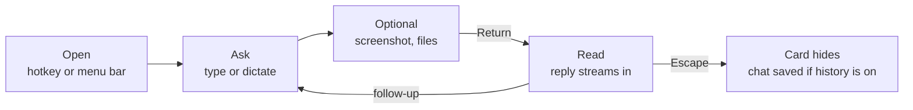
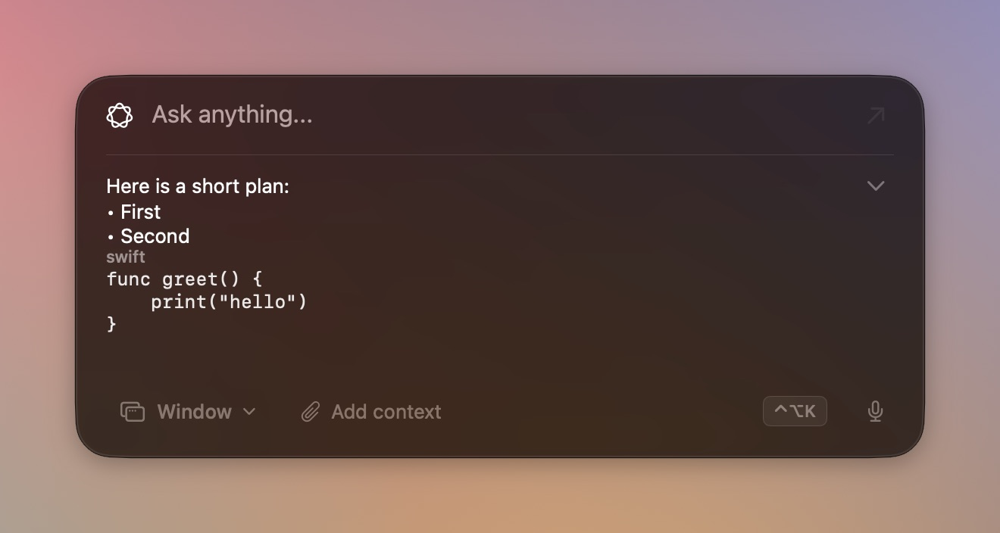

[Docs home](../README.md) · [Next: Providers and models →](providers.md)

# Using Axiom

The card is the whole app: you open it, ask, read the answer, and dismiss it.

| Term | Meaning |
|---|---|
| Card | the glass panel the prompt and reply live in |
| Nonactivating | the card takes your typing without making Axiom the active app, so the app you were in stays in front |
| Lip | the strip under the card that shows errors and status |
| Ask / Agent | Ask answers briefly with no tools; Agent may use tools ([Agent mode](agent-mode.md)) |

## Open and dismiss

Control-Option-K shows and hides the card. The menu-bar icon also has Show, Settings and Quit, and Debug once
**Debug tools** is on in Settings → About.

- The card opens on the screen under the pointer, centred left to right and a third of the way down.
- A reply grows the card downward from where it opened. Only when it reaches the bottom of the screen does the top move
  up, and only by the part that does not fit. After 30 lines the reply scrolls.
- Escape hides the card. A click outside hides it too, unless Settings → General → **Keep the card up** is on, or the
  reply has finished.

## Prompts

Type and press Return. The field is one line by default; turn on **Multiline prompt** in Settings → General and it
wraps up to 10 lines, with Option-Return or Shift-Return for a new line.

While a request runs, the text you sent stays in the field, locked, with a light sweeping through it. A finished reply
clears the field. A failure puts the text back so you can retry. Stop puts the prompt, its files and an armed
screenshot back if nothing had arrived yet.

Replies render headings, lists, links and fenced code. The chevron on the right opens the rest of the thread, so you can
scroll back through earlier turns.

## Screenshots

**Screen** and **Window** arm the next send.

| Choice | Captures | Needs |
|---|---|---|
| Screen | the display the card is on | Screen Recording |
| Window | the front window of the app you were using | Screen Recording and Accessibility |

The card stays up while the shot is taken; it is left out of the image. A highlight shows what will be captured.
Control-S steps through Screen, Window and off.

## Files

**Add context** (Control-C) attaches up to 4 files of up to 4 MB each. Text files are sent as text and images as JPEG.
Other file types are refused with a message on the lip.

## Dictation and the wake word

The mic button, or Control-', dictates into the field. While it listens the card shows a waveform.

- **Wake on Axiom** (Settings → General, off by default) listens for "Axiom" or "Hey Axiom" at the start of a phrase,
  then opens the card with the rest of the sentence.
- **Pause to send** (on by default) sends after about two seconds of silence once the field has text. Nothing sends while
  a reply is still arriving.

Both need Microphone and Speech Recognition, which Settings asks for. See [Privacy and data](privacy-and-data.md).

## History

History is off by default. Turn it on in Settings → History and each finished chat is kept on this Mac. While it is on,
the shortcut badge on the card becomes an incognito mark: click it, or press Control-R, to leave the current chat out.
Details are in [Privacy and data](privacy-and-data.md#history).

## Appearance

Settings → Appearance:

| Setting | Effect |
|---|---|
| Finish | Glass is clear; Matte is heavier glass |
| Glass amount | 100% is clear; lower values tint the card |
| New UI | splits the card into a prompt capsule with separate floating buttons; off by default |

## Shortcuts

| Default | Does |
|---|---|
| Control-Option-K | show or hide the card, from anywhere |
| Return | send |
| Option-Return, Shift-Return | new line (multiline on) |
| Escape | hide the card |
| Control-A | switch Ask and Agent, when the control shows |
| Control-S | Screen, Window, off |
| Control-C | add files |
| Control-R | leave this chat out of history |
| Control-' | dictation |

Each one has a recorder in Settings → General, and the card shows the shortcut you saved.

[Docs home](../README.md) · [Next: Providers and models →](providers.md)
